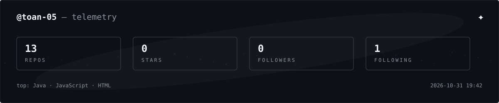

  <picture>
    <source media="(prefers-color-scheme: dark)" srcset="./assets/space-banner-dark.svg">
    <source media="(prefers-color-scheme: light)" srcset="./assets/space-banner-light.svg">
    
  </picture>

  <picture>
    <source media="(prefers-color-scheme: dark)" srcset="https://readme-typing-svg.demolab.com?font=Consolas&size=16&pause=1200&color=F0F6FC&center=true&vCenter=true&width=500&height=30&lines=backend+developer;starry+sky+online&transparent=true">
    <source media="(prefers-color-scheme: light)" srcset="https://readme-typing-svg.demolab.com?font=Consolas&size=16&pause=1200&color=1F2328&center=true&vCenter=true&width=500&height=30&lines=backend+developer;starry+sky+online&transparent=true">
    
  </picture>

  <picture>
    <source media="(prefers-color-scheme: dark)" srcset="https://img.shields.io/badge/ROLE-BACKEND-0d1117?style=flat-square&labelColor=0d1117">
    <source media="(prefers-color-scheme: light)" srcset="https://img.shields.io/badge/ROLE-BACKEND-eaeef2?style=flat-square&labelColor=eaeef2">
    
  </picture>
  <picture>
    <source media="(prefers-color-scheme: dark)" srcset="https://img.shields.io/badge/STACK-NODE.JS-0d1117?style=flat-square&labelColor=0d1117">
    <source media="(prefers-color-scheme: light)" srcset="https://img.shields.io/badge/STACK-NODE.JS-eaeef2?style=flat-square&labelColor=eaeef2">
    
  </picture>
  <picture>
    <source media="(prefers-color-scheme: dark)" srcset="https://img.shields.io/badge/SKY-STARRY-0d1117?style=flat-square&labelColor=0d1117">
    <source media="(prefers-color-scheme: light)" srcset="https://img.shields.io/badge/SKY-STARRY-eaeef2?style=flat-square&labelColor=eaeef2">
    
  </picture>

   
  

 

  <picture>
    <source media="(prefers-color-scheme: dark)" srcset="./assets/metrics-dark.svg">
    <source media="(prefers-color-scheme: light)" srcset="./assets/metrics-light.svg">
    
  </picture>

  LOADED MODULES
    

  LANGUAGE 
  <picture><source media="(prefers-color-scheme: dark)" srcset="https://img.shields.io/badge/Java-0d1117?style=flat-square&logo=openjdk&logoColor=white"><source media="(prefers-color-scheme: light)" srcset="https://img.shields.io/badge/Java-eaeef2?style=flat-square&logo=openjdk&logoColor=black"></picture>
  <picture><source media="(prefers-color-scheme: dark)" srcset="https://img.shields.io/badge/TypeScript-0d1117?style=flat-square&logo=typescript&logoColor=white"><source media="(prefers-color-scheme: light)" srcset="https://img.shields.io/badge/TypeScript-eaeef2?style=flat-square&logo=typescript&logoColor=black"></picture>
  <picture><source media="(prefers-color-scheme: dark)" srcset="https://img.shields.io/badge/HTML5-0d1117?style=flat-square&logo=html5&logoColor=white"><source media="(prefers-color-scheme: light)" srcset="https://img.shields.io/badge/HTML5-eaeef2?style=flat-square&logo=html5&logoColor=black"></picture>
  <picture><source media="(prefers-color-scheme: dark)" srcset="https://img.shields.io/badge/SCSS-0d1117?style=flat-square&logo=sass&logoColor=white"><source media="(prefers-color-scheme: light)" srcset="https://img.shields.io/badge/SCSS-eaeef2?style=flat-square&logo=sass&logoColor=black"></picture>
  <picture><source media="(prefers-color-scheme: dark)" srcset="https://img.shields.io/badge/SQL-0d1117?style=flat-square"><source media="(prefers-color-scheme: light)" srcset="https://img.shields.io/badge/SQL-eaeef2?style=flat-square"></picture>
    

  BACKEND 
  <picture><source media="(prefers-color-scheme: dark)" srcset="https://img.shields.io/badge/Spring_Boot-0d1117?style=flat-square&logo=springboot&logoColor=white"><source media="(prefers-color-scheme: light)" srcset="https://img.shields.io/badge/Spring_Boot-eaeef2?style=flat-square&logo=springboot&logoColor=black"></picture>
  <picture><source media="(prefers-color-scheme: dark)" srcset="https://img.shields.io/badge/Spring_Data_JPA-0d1117?style=flat-square&logo=spring&logoColor=white"><source media="(prefers-color-scheme: light)" srcset="https://img.shields.io/badge/Spring_Data_JPA-eaeef2?style=flat-square&logo=spring&logoColor=black"></picture>
  <picture><source media="(prefers-color-scheme: dark)" srcset="https://img.shields.io/badge/Hibernate-0d1117?style=flat-square&logo=hibernate&logoColor=white"><source media="(prefers-color-scheme: light)" srcset="https://img.shields.io/badge/Hibernate-eaeef2?style=flat-square&logo=hibernate&logoColor=black"></picture>
  <picture><source media="(prefers-color-scheme: dark)" srcset="https://img.shields.io/badge/RESTful_API-0d1117?style=flat-square"><source media="(prefers-color-scheme: light)" srcset="https://img.shields.io/badge/RESTful_API-eaeef2?style=flat-square"></picture>
  <picture><source media="(prefers-color-scheme: dark)" srcset="https://img.shields.io/badge/Maven-0d1117?style=flat-square&logo=apachemaven&logoColor=white"><source media="(prefers-color-scheme: light)" srcset="https://img.shields.io/badge/Maven-eaeef2?style=flat-square&logo=apachemaven&logoColor=black"></picture>
    

  SECURITY 
  <picture><source media="(prefers-color-scheme: dark)" srcset="https://img.shields.io/badge/Spring_Security-0d1117?style=flat-square&logo=springsecurity&logoColor=white"><source media="(prefers-color-scheme: light)" srcset="https://img.shields.io/badge/Spring_Security-eaeef2?style=flat-square&logo=springsecurity&logoColor=black"></picture>
  <picture><source media="(prefers-color-scheme: dark)" srcset="https://img.shields.io/badge/JWT-0d1117?style=flat-square&logo=jsonwebtokens&logoColor=white"><source media="(prefers-color-scheme: light)" srcset="https://img.shields.io/badge/JWT-eaeef2?style=flat-square&logo=jsonwebtokens&logoColor=black"></picture>
  <picture><source media="(prefers-color-scheme: dark)" srcset="https://img.shields.io/badge/Rate_Limiting-0d1117?style=flat-square"><source media="(prefers-color-scheme: light)" srcset="https://img.shields.io/badge/Rate_Limiting-eaeef2?style=flat-square"></picture>
    

  FRONTEND 
  <picture><source media="(prefers-color-scheme: dark)" srcset="https://img.shields.io/badge/Angular-0d1117?style=flat-square&logo=angular&logoColor=white"><source media="(prefers-color-scheme: light)" srcset="https://img.shields.io/badge/Angular-eaeef2?style=flat-square&logo=angular&logoColor=black"></picture>
  <picture><source media="(prefers-color-scheme: dark)" srcset="https://img.shields.io/badge/React-0d1117?style=flat-square&logo=react&logoColor=white"><source media="(prefers-color-scheme: light)" srcset="https://img.shields.io/badge/React-eaeef2?style=flat-square&logo=react&logoColor=black"></picture>
    

  DATABASE 
  <picture><source media="(prefers-color-scheme: dark)" srcset="https://img.shields.io/badge/MySQL-0d1117?style=flat-square&logo=mysql&logoColor=white"><source media="(prefers-color-scheme: light)" srcset="https://img.shields.io/badge/MySQL-eaeef2?style=flat-square&logo=mysql&logoColor=black"></picture>
  <picture><source media="(prefers-color-scheme: dark)" srcset="https://img.shields.io/badge/PostgreSQL-0d1117?style=flat-square&logo=postgresql&logoColor=white"><source media="(prefers-color-scheme: light)" srcset="https://img.shields.io/badge/PostgreSQL-eaeef2?style=flat-square&logo=postgresql&logoColor=black"></picture>
  <picture><source media="(prefers-color-scheme: dark)" srcset="https://img.shields.io/badge/Redis-0d1117?style=flat-square&logo=redis&logoColor=white"><source media="(prefers-color-scheme: light)" srcset="https://img.shields.io/badge/Redis-eaeef2?style=flat-square&logo=redis&logoColor=black"></picture>
  <picture><source media="(prefers-color-scheme: dark)" srcset="https://img.shields.io/badge/Flyway-0d1117?style=flat-square&logo=flyway&logoColor=white"><source media="(prefers-color-scheme: light)" srcset="https://img.shields.io/badge/Flyway-eaeef2?style=flat-square&logo=flyway&logoColor=black"></picture>
    

  DEVOPS · TOOLS · DOCS 
  <picture><source media="(prefers-color-scheme: dark)" srcset="https://img.shields.io/badge/Git-0d1117?style=flat-square&logo=git&logoColor=white"><source media="(prefers-color-scheme: light)" srcset="https://img.shields.io/badge/Git-eaeef2?style=flat-square&logo=git&logoColor=black"></picture>
  <picture><source media="(prefers-color-scheme: dark)" srcset="https://img.shields.io/badge/GitHub-0d1117?style=flat-square&logo=github&logoColor=white"><source media="(prefers-color-scheme: light)" srcset="https://img.shields.io/badge/GitHub-eaeef2?style=flat-square&logo=github&logoColor=black"></picture>
  <picture><source media="(prefers-color-scheme: dark)" srcset="https://img.shields.io/badge/GitHub_Actions-0d1117?style=flat-square&logo=githubactions&logoColor=white"><source media="(prefers-color-scheme: light)" srcset="https://img.shields.io/badge/GitHub_Actions-eaeef2?style=flat-square&logo=githubactions&logoColor=black"></picture>
  <picture><source media="(prefers-color-scheme: dark)" srcset="https://img.shields.io/badge/Docker-0d1117?style=flat-square&logo=docker&logoColor=white"><source media="(prefers-color-scheme: light)" srcset="https://img.shields.io/badge/Docker-eaeef2?style=flat-square&logo=docker&logoColor=black"></picture>
  <picture><source media="(prefers-color-scheme: dark)" srcset="https://img.shields.io/badge/Nginx-0d1117?style=flat-square&logo=nginx&logoColor=white"><source media="(prefers-color-scheme: light)" srcset="https://img.shields.io/badge/Nginx-eaeef2?style=flat-square&logo=nginx&logoColor=black"></picture>
  <picture><source media="(prefers-color-scheme: dark)" srcset="https://img.shields.io/badge/Node.js-0d1117?style=flat-square&logo=nodedotjs&logoColor=white"><source media="(prefers-color-scheme: light)" srcset="https://img.shields.io/badge/Node.js-eaeef2?style=flat-square&logo=nodedotjs&logoColor=black"></picture>
  <picture><source media="(prefers-color-scheme: dark)" srcset="https://img.shields.io/badge/Postman-0d1117?style=flat-square&logo=postman&logoColor=white"><source media="(prefers-color-scheme: light)" srcset="https://img.shields.io/badge/Postman-eaeef2?style=flat-square&logo=postman&logoColor=black"></picture>
  <picture><source media="(prefers-color-scheme: dark)" srcset="https://img.shields.io/badge/Swagger_OpenAPI-0d1117?style=flat-square&logo=swagger&logoColor=white"><source media="(prefers-color-scheme: light)" srcset="https://img.shields.io/badge/Swagger_OpenAPI-eaeef2?style=flat-square&logo=swagger&logoColor=black"></picture>
    

  ARCHITECTURE · DOMAIN 
  <picture><source media="(prefers-color-scheme: dark)" srcset="https://img.shields.io/badge/OOP-0d1117?style=flat-square"><source media="(prefers-color-scheme: light)" srcset="https://img.shields.io/badge/OOP-eaeef2?style=flat-square"></picture>
  <picture><source media="(prefers-color-scheme: dark)" srcset="https://img.shields.io/badge/SOLID-0d1117?style=flat-square"><source media="(prefers-color-scheme: light)" srcset="https://img.shields.io/badge/SOLID-eaeef2?style=flat-square"></picture>
  <picture><source media="(prefers-color-scheme: dark)" srcset="https://img.shields.io/badge/Clean_Architecture-0d1117?style=flat-square"><source media="(prefers-color-scheme: light)" srcset="https://img.shields.io/badge/Clean_Architecture-eaeef2?style=flat-square"></picture>
  <picture><source media="(prefers-color-scheme: dark)" srcset="https://img.shields.io/badge/ERP-0d1117?style=flat-square"><source media="(prefers-color-scheme: light)" srcset="https://img.shields.io/badge/ERP-eaeef2?style=flat-square"></picture>

 

  <picture>
    <source media="(prefers-color-scheme: dark)" srcset="https://github-readme-stats-salesp07.vercel.app/api?username=toan-05&show_icons=true&hide_border=true&bg_color=0d1117&title_color=f0f6fc&text_color=8b949e&icon_color=f0f6fc">
    <source media="(prefers-color-scheme: light)" srcset="https://github-readme-stats-salesp07.vercel.app/api?username=toan-05&show_icons=true&hide_border=true&bg_color=ffffff&title_color=1f2328&text_color=656d76&icon_color=1f2328">
    
  </picture>
  <picture>
    <source media="(prefers-color-scheme: dark)" srcset="https://streak-stats.demolab.com?user=toan-05&hide_border=true&background=0d1117&ring=f0f6fc&fire=f0f6fc&currStreakNum=f0f6fc&currStreakLabel=8b949e&sideNums=8b949e&sideLabels=8b949e&dates=6e7681">
    <source media="(prefers-color-scheme: light)" srcset="https://streak-stats.demolab.com?user=toan-05&hide_border=true&background=ffffff&ring=1f2328&fire=1f2328&currStreakNum=1f2328&currStreakLabel=656d76&sideNums=656d76&sideLabels=656d76&dates=656d76">
    
  </picture>

 

  <picture>
    <source media="(prefers-color-scheme: dark)" srcset="./assets/github-snake-dark.svg">
    <source media="(prefers-color-scheme: light)" srcset="./assets/github-snake.svg">
    
  </picture>

